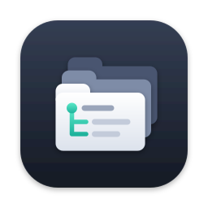

# DevStruct

지정한 폴더 아래의 git 저장소를 `소유자/저장소명` 구조로 자동 정리해주는 macOS 메뉴바 앱입니다.

저장소 이름이 바뀌거나 소유권이 이전되면 폴더와 git remote를 맞춰줍니다. 
fork는 `OpenSource` 폴더로 모읍니다. 
IDE나 에디터가 켜져 있으면 기다렸다가 꺼지면 옮기고, 도구가 기억하는 프로젝트 경로도 함께 바꿉니다.

### 지원 도구

&nbsp;&nbsp;&nbsp;&nbsp;&nbsp;&nbsp;&nbsp;&nbsp;&nbsp;&nbsp;&nbsp;&nbsp;&nbsp;&nbsp;&nbsp;&nbsp;

